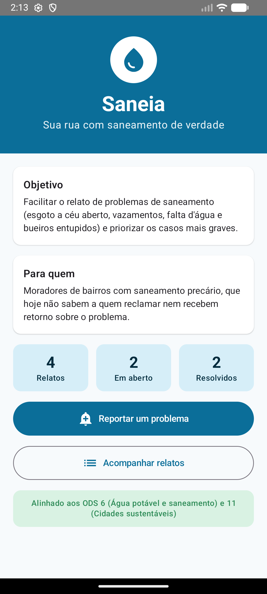
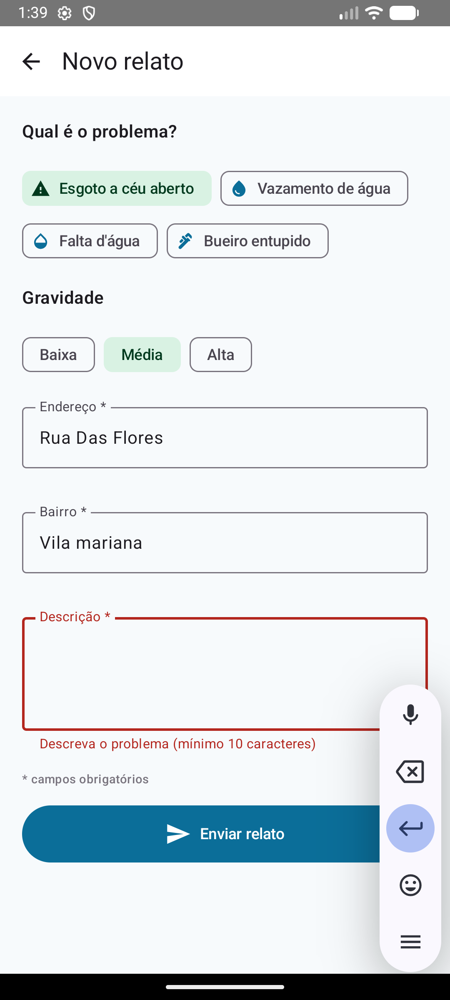
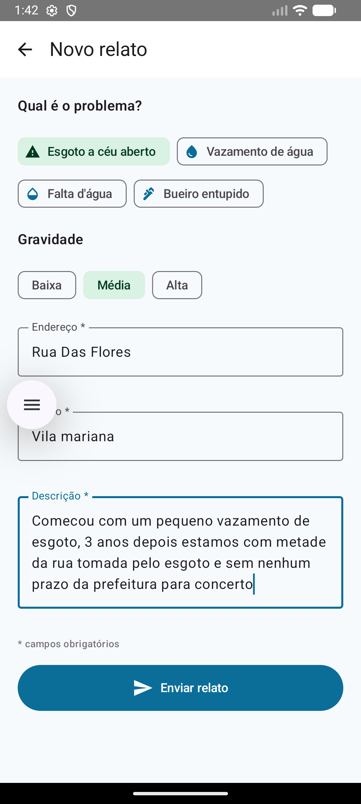
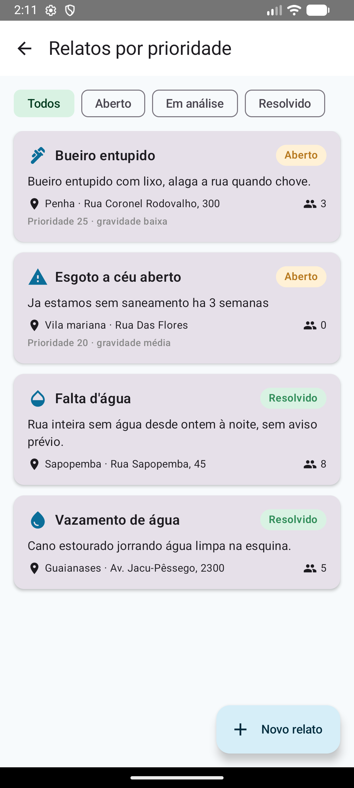
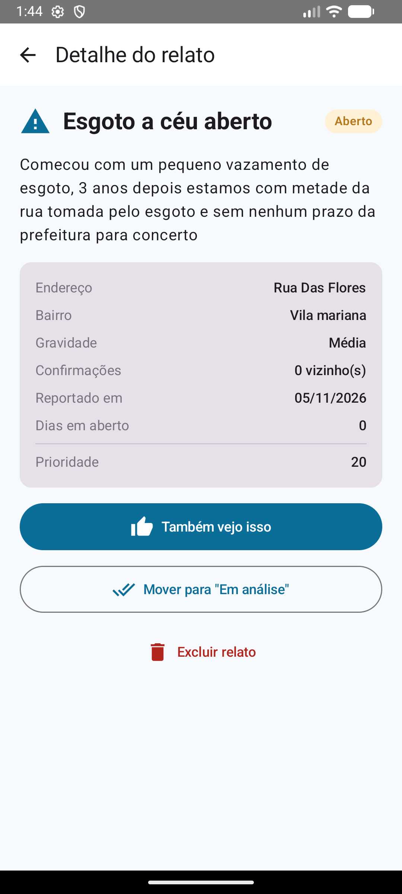
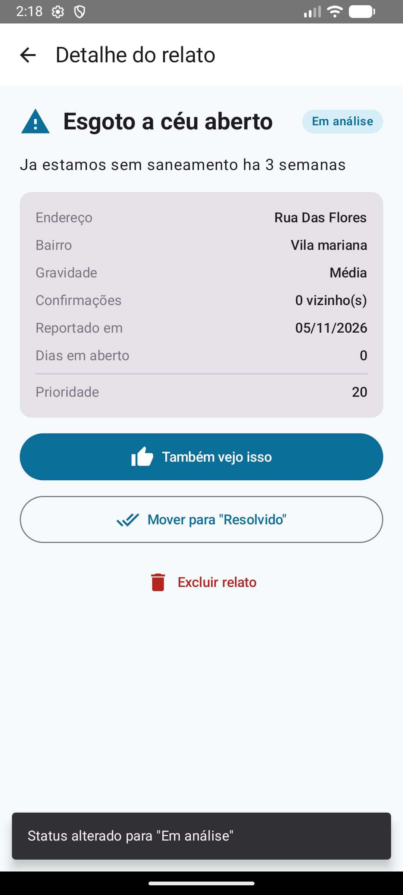
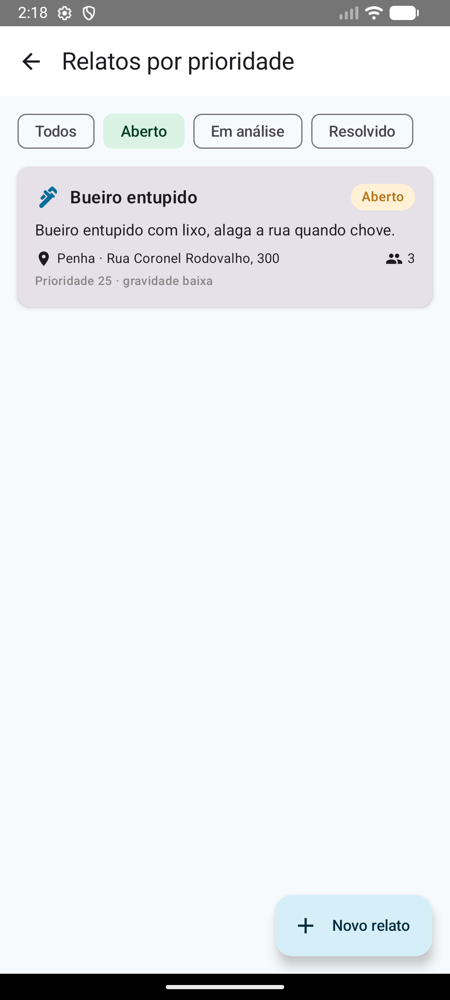
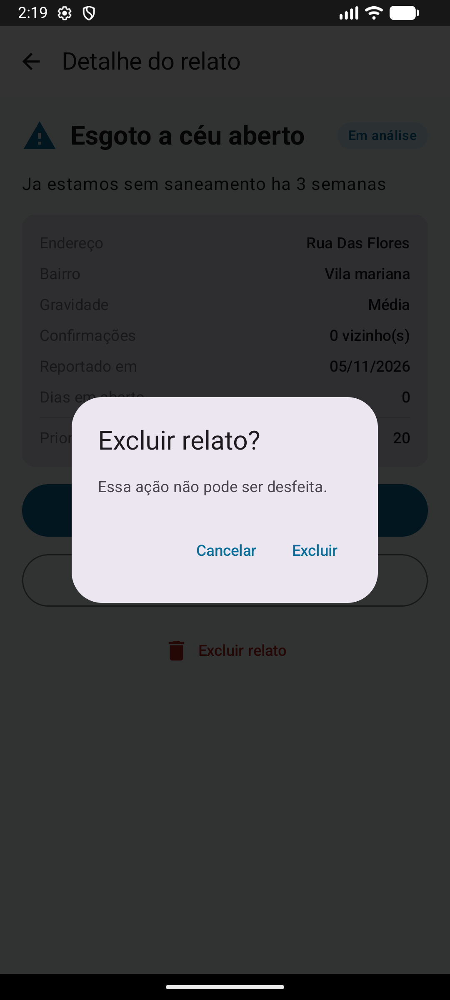

# Saneia — Sua rua com saneamento de verdade

Global Solution 2026.2 · CitizenTech · Android Kotlin Developer

**Equipe:** _[R&J Tech]_
**Integrantes:** _[Rebeca Berbert Barcelos - 556683]_ · _[Julia Mendes Pessoa Dutra — 557645]_

---

## Problema

Esgoto a céu aberto, vazamentos, falta d'água e bueiros entupidos fazem parte do dia a dia de muitos bairros, principalmente na periferia. Esses problemas causam doenças, pioram os alagamentos e desvalorizam a região.

Hoje, quem convive com o problema não sabe a quem reclamar, liga para um 0800 e não recebe retorno. Do outro lado, prefeitura e concessionária recebem reclamações soltas, sem localização clara e sem saber o que é mais urgente.

## Público beneficiado

Moradores de bairros com saneamento precário, que querem reportar o problema da sua rua de forma simples e acompanhar o que acontece com ele.

## Proposta

A Saneia é um app em que o morador **reporta** um problema de saneamento, os vizinhos **confirmam** que também veem o problema e o app **ordena os relatos por prioridade**:

```
prioridade = gravidade × 10 + confirmações × 2 + dias em aberto
```

Assim, os casos mais graves, mais confirmados e mais antigos aparecem primeiro, e o morador acompanha o status de cada relato (Aberto → Em análise → Resolvido).

## ODS relacionados

- **ODS 6 — Água potável e saneamento:** o app ajuda a identificar e acompanhar falhas de esgoto e abastecimento de água, contribuindo para a meta de acesso a saneamento adequado.
- **ODS 11 — Cidades e comunidades sustentáveis:** dá voz ao morador na gestão do espaço urbano e ajuda a priorizar os problemas que mais afetam a qualidade de vida no bairro.

## Funcionalidades

- **Tela inicial** com nome, objetivo, público, ODS e resumo de relatos (total, em aberto e resolvidos)
- **Cadastro de relato** com categoria, gravidade, endereço, bairro e descrição
- **Validação** dos campos obrigatórios (endereço, bairro e descrição): o relato não é salvo com informação inválida e o campo mostra o erro
- **Lista de acompanhamento** ordenada por prioridade, com filtro por status e mensagem para lista vazia
- **Detalhe do relato** com todos os dados, dias em aberto e prioridade
- **Ações adicionais** sobre os registros:
  - *Também vejo isso:* confirma o relato (+1 confirmação)
  - *Alterar status:* Aberto → Em análise → Resolvido
  - *Excluir:* com diálogo de confirmação
- **Mensagens (Snackbar)** a cada ação realizada
- **Persistência local:** os relatos continuam salvos após fechar e abrir o app
- **Dados de exemplo:** na primeira abertura, o banco é preenchido com 5 relatos fictícios

## Tecnologias utilizadas

| Tecnologia | Uso no projeto |
| --- | --- |
| Kotlin | Linguagem do app |
| Jetpack Compose + Material 3 | Interface (Scaffold, TopAppBar, Card, LazyColumn, Row, Column, OutlinedTextField, Button, FilterChip, Snackbar, AlertDialog) |
| Navigation Compose | Navegação entre as telas |
| ViewModel + StateFlow | Estado das telas e regras de apresentação |
| Room (+ KSP) | Banco de dados local |
| Coroutines / Flow | Operações assíncronas e atualização automática da interface |

## Arquitetura e organização

O projeto separa **interface**, **dados** e **lógica de apresentação**:

```
app/src/main/java/br/com/fiap/saneia/
├── MainActivity.kt
├── data/                 # Dados
│   ├── Relato.kt         # Entidade Room + enums (Categoria, Gravidade, StatusRelato)
│   ├── RelatoDao.kt      # Consultas e operações no banco
│   ├── SaneiaDatabase.kt # Banco Room + inserção dos dados de exemplo
│   ├── RelatoRepository.kt
│   └── DadosMock.kt      # Relatos fictícios
├── viewmodel/            # Lógica de apresentação
│   ├── RelatosViewModel.kt   # Lista, filtro, resumo, ações e mensagens
│   └── CadastroViewModel.kt  # Estado do formulário e validação
└── ui/                   # Interface
    ├── theme/Theme.kt
    ├── components/RelatoCard.kt
    ├── navigation/SaneiaNavHost.kt
    └── screens/          # Início, Lista, Cadastro e Detalhe
```

A interface observa o banco por meio de `Flow`: quando um relato é criado, confirmado, alterado ou excluído, a tela é atualizada automaticamente.

### Entidade `Relato`

| Atributo | Tipo | Descrição |
| --- | --- | --- |
| id | Long | Identificador (gerado automaticamente) |
| categoria | Categoria | Esgoto, vazamento, falta d'água ou bueiro |
| descricao | String | Descrição do problema |
| endereco | String | Endereço do problema |
| bairro | String | Bairro |
| gravidade | Gravidade | Baixa, média ou alta |
| confirmacoes | Int | Quantos vizinhos confirmaram |
| status | StatusRelato | Aberto, em análise ou resolvido |
| dataCriacao | Long | Data do relato |

## Fluxo principal

1. Na **tela inicial**, o morador toca em *Reportar um problema*.
2. Em **Novo relato**, escolhe a categoria e a gravidade e preenche endereço, bairro e descrição. Se faltar algum campo obrigatório, o app mostra o erro e não salva.
3. Ao enviar, o relato é salvo no Room e o app abre a **lista de relatos**, ordenada por prioridade, com a mensagem de sucesso.
4. Ao tocar em um relato, o **detalhe** permite confirmar, avançar o status ou excluir.
5. Ao fechar e abrir o app de novo, todos os relatos e alterações continuam lá.

## Como executar

**Requisitos:** Android Studio (versão Koala ou mais recente), JDK 17 e um emulador ou celular com Android 7.0 (API 24) ou superior.

1. Abra o Android Studio e escolha **File > Open**, selecionando a pasta `Saneia`.
2. Aguarde o *Gradle Sync* terminar (na primeira vez, o Android Studio baixa as dependências).
3. Selecione um emulador ou celular e clique em **Run ▶**.

## Capturas de tela

### 1. Tela inicial


### 2. Validação do formulário


### 3. Cadastro de um relato


### 4. Lista com o novo relato


### 5. Ação adicional (confirmação)


### 6. Tela de apps abertos


### 7. Persistência da lista após fechar e abrir o app


### 8. Registro da ação de mudança de status
   

### 9. Relatos após a mudança de status


### 10. Confirmação da opção de excluir um relato

